  <h1>Hi, I'm itsfour 👋</h1>
  
  

    
    
  

---

## 📊 GitHub at a glance

  
  

## 🦉 Duolingo progress

  

## 🧩 Open-source contributions

- [Vendicated/Vencord](https://github.com/Vendicated/Vencord)
- [Team-BTMC/ppcounter-overlay](https://github.com/Team-BTMC/ppcounter-overlay)

## 🕘 Recent activity

  
Show latest public GitHub activity

<!--START_SECTION:activity-->
1. 📦 Pushed [`ad9b20d`](https://github.com/itsfour/profile-readme/commit/ad9b20db63d03c5e78200f23ac053fade034aab9) to [`main`] in [itsfour/profile-readme](https://github.com/itsfour/profile-readme) · 4d ago
2. 📦 Pushed [`3ef243e`](https://github.com/itsfour/profile-readme/commit/3ef243e0b6a609ede2bca4c3788b395a9c40d691) to [`main`] in [itsfour/profile-readme](https://github.com/itsfour/profile-readme) · 4d ago
3. 🌿 Created branch [`main`] in [itsfour/profile-readme](https://github.com/itsfour/profile-readme) ([view](https://github.com/itsfour/profile-readme/tree/main)) · 4d ago
4. 📦 Pushed [`0a3fde8`](https://github.com/itsfour/itsfour/commit/0a3fde8abe421884eaf294fd131d34ea26d75757) to [`main`] in [itsfour/itsfour](https://github.com/itsfour/itsfour) · 4d ago
5. 📦 Pushed [`32ecd03`](https://github.com/itsfour/itsfour/commit/32ecd0361ebf4830b36edc7f009e18ad4d9c82ab) to [`main`] in [itsfour/itsfour](https://github.com/itsfour/itsfour) · 4d ago
6. 📦 Pushed [`173a019`](https://github.com/itsfour/profile-readme/commit/173a01936e78500ebe067a266ce223848f375df9) to [`main`] in [itsfour/profile-readme](https://github.com/itsfour/profile-readme) · 4d ago
7. 📦 Pushed [`6c8d3fd`](https://github.com/itsfour/profile-readme/commit/6c8d3fd9a106503a1fc0af777e88d91605b98b77) to [`main`] in [itsfour/profile-readme](https://github.com/itsfour/profile-readme) · 4d ago
8. 📦 Pushed [`682a4b5`](https://github.com/itsfour/itsfour/commit/682a4b54860f1cf24913fd33ab29870a19c22181) to [`main`] in [itsfour/itsfour](https://github.com/itsfour/itsfour) · 4d ago
9. 📦 Pushed [`4439848`](https://github.com/itsfour/itsfour/commit/4439848af062600479982006a0d0aef5794728e0) to [`main`] in [itsfour/itsfour](https://github.com/itsfour/itsfour) · 4d ago
10. 📦 Pushed [`34b17df`](https://github.com/itsfour/itsfour/commit/34b17dfc963ce331ff698757cb0a723e754691fd) to [`main`] in [itsfour/itsfour](https://github.com/itsfour/itsfour) · 4d ago
11. 🌿 Created branch [`main`] in [itsfour/Duo.Assistant](https://github.com/itsfour/Duo.Assistant) ([view](https://github.com/itsfour/Duo.Assistant/tree/main)) · 4d ago
12. 📦 Pushed [`6bef446`](https://github.com/itsfour/profile-readme/commit/6bef446ec5b2adab89366b674c28d9579df15df3) to [`main`] in [itsfour/profile-readme](https://github.com/itsfour/profile-readme) · 4d ago
13. 📦 Pushed [`3369573`](https://github.com/itsfour/profile-readme/commit/3369573d011583c32a036857df87113e59897c1a) to [`main`] in [itsfour/profile-readme](https://github.com/itsfour/profile-readme) · 4d ago
14. 📦 Pushed [`1a181fb`](https://github.com/itsfour/itsfour/commit/1a181fb467f2a945164277883d06d8d7d15bb885) to [`main`] in [itsfour/itsfour](https://github.com/itsfour/itsfour) · 4d ago
15. 📦 Pushed [`79775a6`](https://github.com/itsfour/profile-readme/commit/79775a6870cdb4127e6ee12acfbd3a3da3138ea5) to [`main`] in [itsfour/profile-readme](https://github.com/itsfour/profile-readme) · 4d ago
16. 📦 Pushed [`81b3753`](https://github.com/itsfour/profile-readme/commit/81b3753ea476d88d3ca2772299fc4ba59cf0e069) to [`main`] in [itsfour/profile-readme](https://github.com/itsfour/profile-readme) · 4d ago
17. 📦 Pushed [`14ca528`](https://github.com/itsfour/itsfour.github.io/commit/14ca5282277878cb10dcf75fdf10558caf38dc58) to [`main`] in [itsfour/itsfour.github.io](https://github.com/itsfour/itsfour.github.io) · 6d ago
18. 📦 Pushed [`ce5f338`](https://github.com/itsfour/itsfour.github.io/commit/ce5f33812be3e094cd7525468067db3e10d88aa0) to [`main`] in [itsfour/itsfour.github.io](https://github.com/itsfour/itsfour.github.io) · 6d ago
19. 📦 Pushed [`c22a85c`](https://github.com/itsfour/itsfour.github.io/commit/c22a85cfb46cba8ce78979fdb4c72369ac7677ba) to [`main`] in [itsfour/itsfour.github.io](https://github.com/itsfour/itsfour.github.io) · 6d ago
20. 📦 Pushed [`f6b2681`](https://github.com/itsfour/itsfour.github.io/commit/f6b2681db11797a7d17581c93739eb9a6f1037b7) to [`main`] in [itsfour/itsfour.github.io](https://github.com/itsfour/itsfour.github.io) · Nov 04, 2026 UTC
21. 📦 Pushed [`12d8e31`](https://github.com/itsfour/itsfour.github.io/commit/12d8e31a52a6e967cbcc9d45e33d68b18208dd42) to [`main`] in [itsfour/itsfour.github.io](https://github.com/itsfour/itsfour.github.io) · 6d ago
22. 📦 Pushed [`15e8798`](https://github.com/itsfour/itsfour.github.io/commit/15e879869a6d8b7fbf3e4ca0d1627b271b0319d5) to [`main`] in [itsfour/itsfour.github.io](https://github.com/itsfour/itsfour.github.io) · Nov 04, 2026 UTC
23. 📦 Pushed [`4493e00`](https://github.com/itsfour/itsfour.github.io/commit/4493e0018b81adeefae38f8f926cf51001d2766b) to [`main`] in [itsfour/itsfour.github.io](https://github.com/itsfour/itsfour.github.io) · 6d ago
24. 📦 Pushed [`ae0b849`](https://github.com/itsfour/itsfour.github.io/commit/ae0b8497e100e96e90f912071412d4ca99abee36) to [`main`] in [itsfour/itsfour.github.io](https://github.com/itsfour/itsfour.github.io) · 6d ago
25. 📦 Pushed [`2d386ed`](https://github.com/itsfour/Modified-APK/commit/2d386ed5dea5e7057f659848827560b22056967d) to [`main`] in [itsfour/Modified-APK](https://github.com/itsfour/Modified-APK) · Nov 03, 2026 UTC
<!--END_SECTION:activity-->

